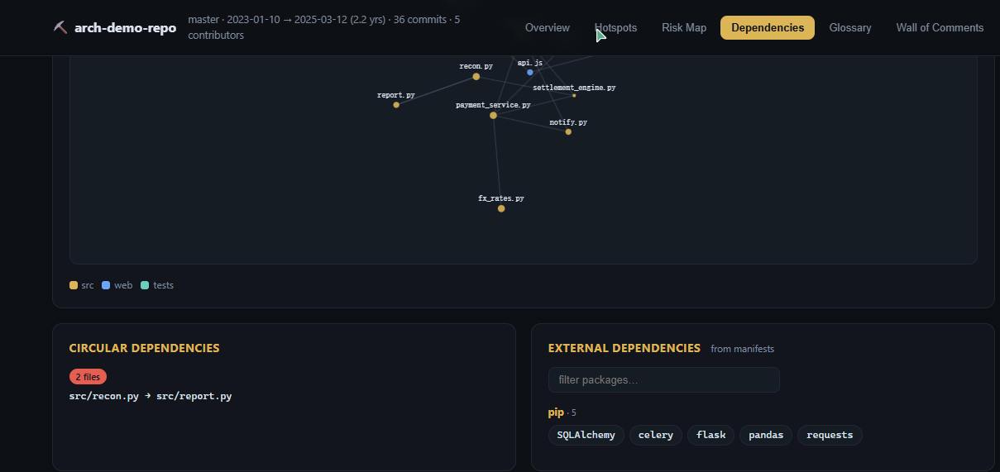
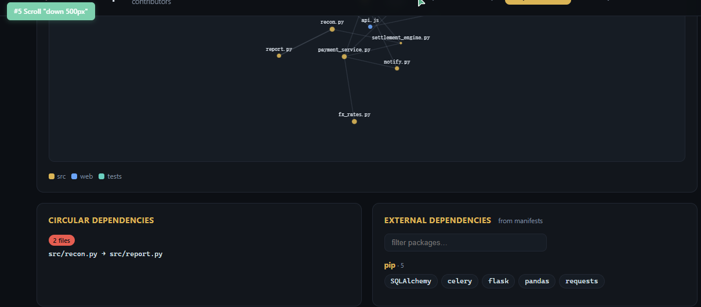

# ⛏️ Repo Archaeologist

**Point it at a legacy repository. Get the full excavation report.**

Every developer has inherited *that* repo: no docs, no tests, authors long gone, and a
`TODO: fix this before launch` from 2016. Existing tools explain **one file at a time**.
Repo Archaeologist maps the whole dig site — where the code actually lives, what breaks
first, and the tribal vocabulary you need to survive code review.

One Python script, zero dependencies, one self-contained HTML report. No config, no agent,
no telemetry. Works on any git repository.

[]()
[]()
[]()



---

## What you get

The excavator (`scripts/analyze.py`) reads git history + source + manifests and produces
`archaeology-report.html` — an interactive, fully self-contained report:

### 🔥 Change hotspots — mined from git log
Which files carry the project: commits, churn, bugfix ratio, author spread, monthly commit
timeline, and *ghost files* (heavy history, since deleted). The de-facto architecture is the
fan-in ranking, not the folder names.

### 🕸️ Dependency graph
Internal import graph (Python / JS-TS-Vue / Java / Kotlin / Go / C# / Ruby / PHP / C / C++ /
Rust / …), fan-in & fan-out rankings, **circular dependency chains**, zombie files nobody
imports, and external dependencies harvested from `package.json`, `requirements.txt`,
`pyproject.toml`, `go.mod`, `pom.xml`, `Cargo.toml`, `Gemfile`, `composer.json`, `*.csproj`.

### 📖 Domain glossary — mined from code comments
The tribal vocabulary hiding in comments: *Settlement Batch*, *RailContract*… with mention
counts and example quotes. The fastest way to sound native in a codebase with no docs.

### 🧨 Refactoring risk map
A Michael Feathers–style quadrant: **Refactor first** (hot + big + untested), **Landmines**
(cold + big — feared and frozen), **Workhorses** (hot but cheap), **Backwaters**. Each file
gets a 0–100 risk score from commits, bugfix ratio, size, blast radius and test presence —
with the evidence shown, not just the verdict.



### 💀 Wall of legacy comments
Every `TODO / FIXME / HACK / XXX / WORKAROUND / DO NOT TOUCH` the excavator unearths —
the oral history of the repo. This tab is why your teammates will actually open the report.

## Quick start

### Standalone (no agent needed)

```bash
python scripts/analyze.py /path/to/legacy-repo
# → archaeology-report/archaeology-report.html  (just open it)
```

Requirements: **Python 3.8+** and a **git checkout**. Nothing else. On huge repos:

```bash
python scripts/analyze.py . --since 2022-01-01 --exclude "*.gen.*" -o report
```

### As an agent skill

Copy this folder into your agent's skills directory (Trae, Claude Code, opencode, etc.) —
the skill instructs the agent to run the excavator, read the data, and deliver the part a
script can't: the narrative. Headline, blast zone, reading order for week one, and a
30/60/90 refactor plan, embedded into the report as notes.

## Demo

Open [`docs/demo/archaeology-report.html`](docs/demo/archaeology-report.html) — a report of
a deliberately cursed fictional payments monolith (generated by this tool, zero post-editing).

## How it works

| Layer | Signal | Meaning |
|---|---|---|
| `git log --numstat` | commits · churn · bugfix ratio | where the pain is |
| import extraction | fan-in · fan-out · SCC cycles | blast radius & the real architecture |
| comment mining | repeated domain terms · TODO/FIXME wall | tribal knowledge & graveyards |
| combined score | 0–100 risk + Feathers quadrant | what to touch, in what order |

Full methodology, formulas, and the no-script manual reproduction commands:
[`references/methodology.md`](references/methodology.md).

## Why not just ask an LLM to "explain the repo"?

Because an LLM reading a few files sees the pebbles, not the site. This tool computes things
an LLM cannot feel from a file list: two years of failure pressure concentrated in 4 files,
a 12-file import cycle, 340 zombie lines, the 5 words that appear in every war-story comment.
Agent + excavation data beats either one alone.

## Limitations (honest ones)

- Dependency resolution is static and heuristic — DI containers, reflection and dynamic
  dispatch are invisible.
- The glossary is English-flavored; non-English comments get sparser mining.
- Risk weights are opinionated priors. The report always shows the underlying signals.
- Git history only: squashed histories and vendored code will distort the picture.

## 中文简介

**仓库考古学家**：把无文档祖传仓库挖成一份可交互的考古报告。零依赖、单脚本、零配置——
只要 Python 3.8 和一个 git 仓库。产出四张图：git log 变更热点图、依赖图（含循环依赖与僵尸代码）、
从注释里挖出的领域黑话表、重构风险地图（Feathers 四象限），外加一面「祖训墙」
（前人留下的 TODO/FIXME/HACK）。发给新同事之前先跑一遍，胜过两周口口相传。

## Contributing

Issues and PRs welcome — especially new language support in the import extractors
(one small function each) and better stopword lists for the glossary.

## License

[MIT](LICENSE)
